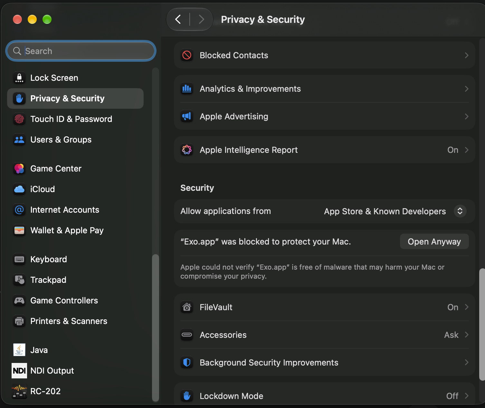
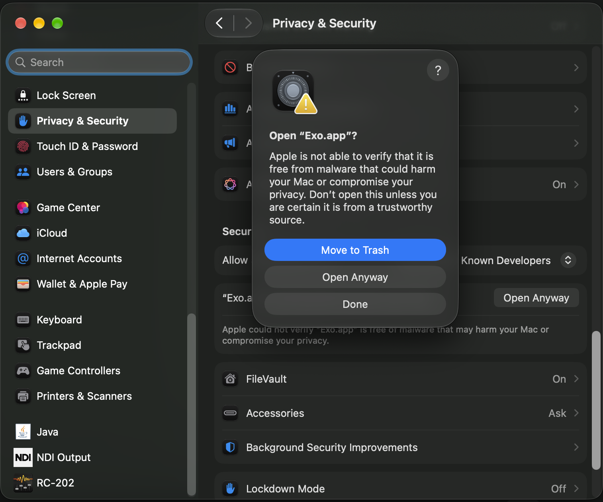

# Install TinyCloud Home on your Mac

TinyCloud Home is signed with TinyCloud, Inc.'s Apple Developer ID and notarized by Apple from 0.14.0-beta.6 on, so it opens like any other app downloaded from the internet: macOS asks once whether to open it, and you click **Open**.

Releases before that, including the current stable 0.13.0, are not signed. macOS blocks those the first time you open them, and you allow them once in System Settings (step 3).

**Requirements:** a Mac with Apple silicon (M1 or newer).

## 1. Download

Download the latest `TinyCloud-Home_<version>_aarch64.dmg` (`Exo_<version>_aarch64.dmg` before 0.14) from the [TinyCloud Home releases page](https://github.com/TinyCloudLabs/tinychat/releases?q=exo-desktop&expanded=true). Pick the newest release that is **not** marked "Pre-release", or the newest pre-release for a signed beta.

## 2. Install

1. Open the downloaded `.dmg`.
2. Drag **TinyCloud Home** into the **Applications** folder.
3. Eject the TinyCloud Home disk image.

## 3. Open it the first time

A signed release (0.14.0-beta.6 or later): open **TinyCloud Home** from Applications and click **Open** when macOS asks. Skip to step 4.

An unsigned release (0.13.0 or earlier):

1. Open **TinyCloud Home** from Applications.
2. macOS says Apple could not verify that "TinyCloud Home.app" is free of malware. Click **Done**, not Move to Trash.
3. Open **System Settings → Privacy & Security** and scroll down to **Security**.
4. Next to *"TinyCloud Home.app" was blocked to protect your Mac*, click **Open Anyway**.

   

5. In the dialog that appears, click **Open Anyway**. Then enter your Mac password or use Touch ID.

   

TinyCloud Home now opens, and from then on it opens like any other app.

> The **Open Anyway** button only appears for about an hour after you try to open TinyCloud Home. If you don't see it, open TinyCloud Home again and go back to Privacy & Security.

## 4. Sign in

1. Click **Open app**, then **Sign in**.
2. Choose **Continue with email** or **Continue with Google**. Passkeys aren't available in this build.
3. For email, enter the 6-digit code from the email, then approve the permissions request.

## 5. Allow recording, if you use Local recording

The first time you start a **Local recording**, macOS asks for access to the **microphone** and to **system audio** (screen and system audio recording). Allow both. If you denied them by mistake, turn them on under **System Settings → Privacy & Security → Microphone** and **Screen & System Audio Recording**, then restart TinyCloud Home.

## Updating

Download the new `.dmg` and drag TinyCloud Home into Applications again, replacing the old one. An unsigned version may need step 3 again; a signed one opens directly.

Or update from Terminal in one step. This also works for a first install:

```bash
curl -fsSL https://raw.githubusercontent.com/TinyCloudLabs/tinychat/main/desktop/scripts/exo-update.sh | bash
```

It downloads the latest stable release over HTTPS from GitHub only, checks it against the release's `SHA256SUMS.txt`, quits TinyCloud Home, replaces `/Applications/TinyCloud Home.app` and opens it. A download made this way isn't marked by macOS, so step 3 isn't needed. You can read the script first: [`desktop/scripts/exo-update.sh`](../desktop/scripts/exo-update.sh).

For the newest build, including betas:

```bash
curl -fsSL https://raw.githubusercontent.com/TinyCloudLabs/tinychat/main/desktop/scripts/exo-update.sh | bash -s -- beta
```

There's no downgrade check: switching from betas back to stable installs the latest stable release even when it's older than the build you have.

## Alternative: Terminal (unsigned releases only)

For an unsigned release, if you'd rather skip System Settings, run this once after step 2, then open TinyCloud Home normally:

```sh
xattr -dr com.apple.quarantine "/Applications/TinyCloud Home.app"
```
